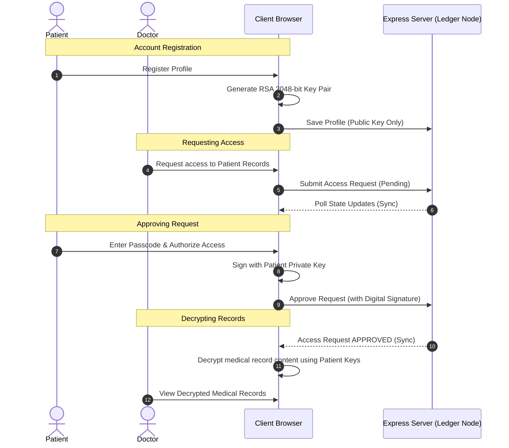

# 🛡️ MedSafe — Prescription Intelligence Network

[](https://react.dev)
[](https://vite.dev)
[](https://tailwindcss.com)
[](https://www.typescriptlang.org)
[](https://expressjs.com)
[](https://firebase.google.com)

**MedSafe** (also known as the *Primacy Patient Medical Ledger*) is a next-generation, patient-centric medical locker system. It solves the critical privacy and security challenges of modern health systems by putting data ownership entirely in the hands of the patient. Through a blend of asymmetric client-side cryptography, dynamic access requests, blockchain-like audit trails, and clinical intelligence, MedSafe ensures that a patient's medical history is encrypted by default and only decrypted when explicit, digitally-signed consent is provided.

---

## 🏗️ Architecture & Security Model

MedSafe operates under a **Zero-Knowledge / Sovereign Identity** paradigm:

1. **Local Key Generation**: Upon account creation, the patient's browser generates a custom **2048-bit RSA Asymmetric Key Pair**. The private key resides only in client-side secure memory.
2. **Client-Side Encryption**: When medical records (prescriptions, lab tests, diagnoses) are uploaded, they are encrypted *in the browser* using the patient's Public Key before transit. The server only sees and stores the ciphertext (`CIPHER_VAULT_AES_256:[IV]:encoded`).
3. **Explicit Consent & Delegation**: Doctors cannot read medical records. To do so, they must submit an **Access Request** specifying the clinical purpose.
4. **Digital Signature**: The patient approves the request using their private key to create a cryptographic digital signature (`SHA256-RSA-SIG:...`).
5. **Decryption on Demand**: Once access is approved, the doctor's browser uses the digital signature and patient details to decrypt the records locally. The server never holds or processes the decrypted content.



---

## ✨ Key Features

- **🔑 Asymmetric Key Management**: Live generation of RSA keycards. Patients copy/download their keys to secure local storage.
- **🗳️ Consent Dashboard**: Patients receive real-time push notifications of access requests and can instantly approve, reject, or revoke clinician privileges.
- **🩺 Doctor Dashboard**:
  - Patient directory lookup.
  - Justified access requests.
  - Record upload interface for prescriptions and reports.
  - Interactive **QR Code Scanner** to quickly identify patients or load cards via in-app webcam stream or image uploads.
- **⚠️ Clinical Drug Interaction Engine**: High-accuracy interaction scanner that automatically tests compiled medical prescriptions against a built-in contraindication catalog (e.g., *Nitroglycerin + Sildenafil*, *Warfarin + Aspirin*, *Lisinopril + Spironolactone*), raising critical alerts and presenting actionable clinician resolutions.
- **📜 Immutable Audit Ledger**: Every major event (login, record creation, key generation, access update) is added to a real-time ledger complete with an integrity verification hash (simulating immutable blocks).
- **🔒 Multi-Factor Authentication (MFA)**:
  - Combined Firebase authentication for email/password.
  - Real-time 6-digit **OTP (One-Time Password) Verification** via SMTP (using Nodemailer) with fallback to terminal/console simulator.

---

## 🛠️ Tech Stack

### Frontend (Client)
- **Framework**: React 19 (SPA, Lazy loaded routes)
- **Bundler**: Vite 6 (Optimized manual code-splitting vendor chunks)
- **Styling**: TailwindCSS 4 (modern, glassmorphism UI/UX themes)
- **Animations**: Motion (Framer Motion) for micro-animations and status transitions
- **QR scanning**: `jsQR` for canvas-based frame-by-frame camera scanning
- **Icons**: Lucide React

### Backend (Server)
- **Server**: Express (Node.js API) run via `tsx`
- **Environment**: Dotenv
- **Mailer**: Nodemailer (Google SMTP configuration)
- **Database**: Seedable stateful in-memory database with real-time poll-based state synchronization (2-second interval)
- **Build tool**: esbuild (Server-side compilation)

---

## 📁 Project Structure

```text
MedSafe/
├── .env                  # local secrets (ignored by Git)
├── .env.example          # environment setup example
├── index.html            # Entry point HTML document (Google fonts loaded)
├── package.json          # Dependency definition
├── server.ts             # Express application & Ledger API
├── tsconfig.json         # TypeScript configuration
├── vite.config.ts        # Vite configuration & Rollup split chunks
├── replace-logo.js       # Utility scripts for asset replacement
├── public/               # Static assets
└── src/
    ├── main.tsx          # React application root mount
    ├── App.tsx           # Global routing & polling synchronization setup
    ├── firebase.ts       # Firebase client configurations
    ├── types.ts          # Core interfaces (UserProfile, MedicalRecord, etc.)
    ├── utils/
    │   └── cryptoSim.ts  # RSA key generators, aes-256 ciphers, and interaction logic
    └── components/
        ├── AuthPage.tsx             # Login, Sign Up, & OTP MFA pages
        ├── DoctorDashboard.tsx      # Dashboard, conflict alerts, & record creator
        ├── PatientDashboard.tsx     # Locker controls, ledger audit log, & consent center
        ├── QRScanner.tsx            # In-app webcam and file-upload QR reader
        ├── EncryptionVisualizer.tsx # Visual feedback showing plain vs cipher states
        ├── LandingPage.tsx          # Product overview hero sections & steps
        └── Logo.tsx                 # Core branding SVG vector logo
```

---

## ⚙️ Environment Configuration

To run the application, copy the example environment file and fill in your configuration:

```bash
cp .env.example .env
```

Define the following environment variables:

| Variable | Description |
| :--- | :--- |
| `PORT` | Local server port (Default: `3000`) |
| `GEMINI_API_KEY` | Google Gemini AI authentication secret (for server-side AI expansions) |
| `APP_URL` | Application root URL |
| `SMTP_SERVER` | Mail server hostname (Default: `smtp.gmail.com`) |
| `SMTP_PORT` | Mail server port (Default: `587` or `465` for secure SSL) |
| `EMAIL` / `SENDER_EMAIL` | Sender email address for OTP notifications |
| `APP_PASSWORD` | Google App Password for mail account authorization (if left empty or set to dummy value, server falls back to simulating OTPs in the terminal) |

> ℹ️ **Note on OTP Simulator**: If `APP_PASSWORD` is not configured, the console will print a helper box containing the active code:
> ```text
> ==================================================
> [OTP SIMULATOR] Generated OTP for user@example.com: 593841
> ==================================================
> ```

---

## 🚀 Getting Started

### 1. Prerequisites
Ensure you have **Node.js (v18+)** and **npm** installed.

### 2. Installation
Clone the repository and install the dependencies:
```bash
npm install
```

### 3. Running Development Server
Launch both the Express backend and the Vite frontend HMR server simultaneously:
```bash
npm run dev
```
Open [http://localhost:3000](http://localhost:3000) in your web browser.

### 4. Building for Production
To build the application for deployment (compiling React client-side assets and bundling server-side modules using `esbuild`):
```bash
npm run build
```

This generates:
- Client-side static assets in `dist/`
- Server-side executable code in `dist/server.cjs`

To start the production server:
```bash
npm run start
```

---

## 👥 Demo User Accounts (Pre-seeded)

For simple testing, the database is pre-seeded with three demo profiles. You can sign in using `password` (passcode: `password` / default OTP codes):

| Name | Role | Email | Details |
| :--- | :--- | :--- | :--- |
| **Eleanor Vance** | Patient | `eleanor@vance.io` | Holds 2 predefined encrypted medical records |
| **Dr. Robert Chen** | Doctor | `chen@metrocardio.org` | Cardiology license. Has an approved access request for Eleanor |
| **Dr. Sarah Lin** | Doctor | `lin@neurohealth.com` | Neurology license. Has a pending access request for Eleanor |

---

## 🔒 Security Recommendations for Production
- **Use Real SSL/TLS**: Ensure the website is served over HTTPS to guarantee secure transmission of keys and avoid webcam blockages on the browser scanner.
- **Secure Storage**: In production, private keys should be kept in secure browser memory (like SessionStorage) or external keystores rather than standard LocalStorage to minimize cross-site scripting (XSS) risks.
