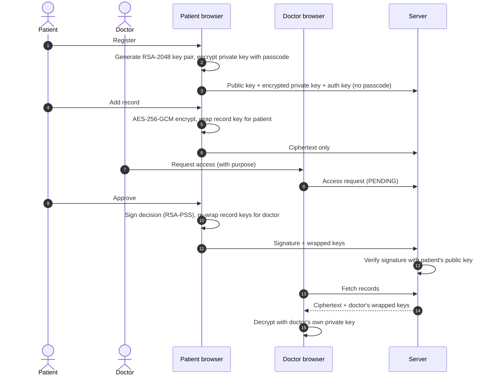

# 🛡️ MedSafe — Patient-Owned Medical Locker

[](https://react.dev)
[](https://vite.dev)
[](https://www.typescriptlang.org)
[](https://expressjs.com)
[](https://developer.mozilla.org/docs/Web/API/SubtleCrypto)

**MedSafe** is a patient-centric medical record locker. Records are encrypted in the patient's browser, the server stores only ciphertext, and a doctor can read a patient's records only after the patient approves the doctor's request with a digital signature.

> **Project status:** a student/hackathon project. The cryptography is real (standard Web Crypto algorithms), but the system has not had a professional security audit and is not certified for real patient data (HIPAA, GDPR, DISHA, etc.). The drug-interaction checker is a small reference list for demonstration, not a clinical tool.

---

## 🏗️ Security model

All cryptography uses the browser's built-in **Web Crypto API** (`crypto.subtle`), and the same code (`src/utils/vaultCrypto.ts`) runs on the server for signature checks.

| What | How |
| :--- | :--- |
| **User keys** | Each user gets an **RSA-2048** key pair generated **in their browser** at sign-up. The same key is used for RSA-OAEP (encryption) and RSA-PSS (signatures). |
| **Private key storage** | The private key is encrypted with **AES-256-GCM** under a key derived from the user's passcode (**PBKDF2-SHA256, 310,000 iterations**). Only that encrypted blob is stored on the server, so the user can sign in from another device. The unlocked key is kept only in memory: after a page reload the user re-enters their passcode. |
| **Passcode** | Never sent to the server. The browser sends a separate PBKDF2-derived *auth key* (different salt), which the server hashes again with **scrypt**. Knowing the auth key does not help decrypt the private key. |
| **Records** | Each record (title, details, medicines, photos) is encrypted with its own random **AES-256-GCM** key. That key is wrapped with **RSA-OAEP** once per reader: the patient, and each doctor the patient has approved. The server sees only metadata (category, date, doctor name) and ciphertext. |
| **Consent** | Approving, declining or revoking a request is signed by the patient (**RSA-PSS / SHA-256**). The server **verifies the signature** with the patient's public key before acting. On approval, the patient's browser re-wraps every record key for the doctor's public key. On revoke, the server deletes the doctor's wrapped keys. |
| **Sign-in** | Passcode check, then a 6-digit email code (cryptographically random, 10-minute expiry, 5 attempts, 30-second resend limit). Failed passcodes lock the account for 15 minutes after 5 tries. Sessions use an **HttpOnly, SameSite=Strict** cookie (Secure in production). |
| **Authorization** | Every API route checks the session and role. Patients can only see and edit their own data. Doctors can only see records whose key was shared with them **and** whose request is still approved. Doctors cannot approve their own requests, and records can only be shared with approved doctors. |
| **Audit log** | Each entry is written by the server with the authenticated actor, and linked to the previous one in a **SHA-256 hash chain** (`GET /api/logs/verify` checks it). Users only see entries that concern them. |

**Known limitations**
- Revoking access stops a doctor from fetching records from then on, but cannot "un-see" data they already decrypted or saved.
- If a user forgets their passcode their records cannot be recovered (there is no key escrow).
- The server serves the JavaScript that does the encryption, so a compromised server could ship malicious code. This is true of every web-based end-to-end encrypted app.
- Sessions and rate limits are kept in memory: restarting the server signs everyone out.



---

## 🔄 Features

1. **Registration & key card** — keys are generated in the browser; the user sees their key card once.
2. **Email OTP sign-in** — Nodemailer over SMTP with TLS certificate checking. In local development without SMTP the code is printed in the server console (and shown on screen only if `OTP_DEV_ECHO=true`). In production, if email cannot be sent, sign-in fails instead of exposing the code.
3. **Doctor search & QR passes** — the patient's QR pass is generated locally (no third-party QR service). Doctors scan it by camera (`jsQR`), image upload, or a demo simulation; matching is exact.
4. **Signed consent** — approve / decline / revoke, all signature-verified on the server. Patients can also pre-authorize a doctor directly.
5. **Encrypted records** — the in-app visualizer shows real AES-GCM output.
6. **AI document reading (optional)** — uploads are sent to Google Gemini (`GEMINI_MODEL`, default `gemini-2.5-flash`) to pre-fill the form. **Privacy note:** this sends the image to Google; without `GEMINI_API_KEY` a local sample template is used instead.
7. **Drug-interaction check** — matches drug *classes* (e.g. any benzodiazepine + any opioid, brand or generic names) against a curated list of ~17 well-known interactions and reports all matches. It is a demo, not a substitute for a clinical interaction database.
8. **Hash-chained audit log** — see the security model above.

---

## 🛠️ Tech stack

- **Frontend:** React 19, Vite 6, Tailwind CSS 4, Motion, jsQR, qrcode, Lucide icons.
- **Backend:** Express, zod (request validation), Nodemailer, Google GenAI SDK, optional Firebase Realtime Database (per-item writes) for persistence.
- **Crypto:** Web Crypto API only — no custom algorithms.
- **Tests:** Vitest (crypto, drug interactions, and API authorization tests).

## 📁 Project structure

```text
├── server.ts                 # Entry point: loads config, store, Vite (dev) or static files (prod)
├── server/
│   ├── app.ts                # All API routes: auth, sessions, authorization, validation
│   ├── store.ts              # In-memory data, hash-chained audit log, demo seed, legacy migration
│   ├── persistence.ts        # Memory or Firebase Realtime Database backends
│   ├── mailer.ts             # OTP email
│   └── ocr.ts                # Gemini document reading + offline fallback
├── src/
│   ├── App.tsx               # Session restore, polling, client-side encrypt/decrypt/sign
│   ├── api.ts                # fetch wrapper
│   ├── types.ts
│   ├── utils/
│   │   ├── vaultCrypto.ts    # RSA-OAEP / RSA-PSS / AES-GCM / PBKDF2 (browser + Node)
│   │   └── drugInteractions.ts
│   └── components/           # Landing, Auth, Patient & Doctor dashboards, QR scanner, ...
├── tests/                    # Vitest suites
├── database.rules.json       # Firebase RTDB rules template (backend account only)
└── .env.example
```

---

## ⚙️ Configuration

Copy `.env.example` to `.env`. All variables are optional for local development.

| Variable | Purpose |
| :--- | :--- |
| `PORT` | Server port (default `3000`). |
| `SMTP_SERVER`, `SMTP_PORT`, `EMAIL`, `APP_PASSWORD` | SMTP settings for OTP emails. **Required in production.** |
| `OTP_DEV_ECHO` | `true` shows the OTP on screen when email is not configured. Ignored in production. |
| `GEMINI_API_KEY`, `GEMINI_MODEL` | Optional AI document reading. |
| `FIREBASE_DATABASE_URL` | Optional persistent storage. If set, `BACKEND_EMAIL` and `BACKEND_PASSWORD` are required. Lock the database down with `database.rules.json` (put your backend email in it). |
| `SEED_DEMO_DATA` | Create the demo accounts on an empty database. Default: on in development, off in production. |
| `ALLOW_DEMO_RESET` | Allow `POST /api/reset` in development. Always off in production. |

**Upgrading from the old version:** on first start, data in the old format is migrated automatically. Accounts get real key pairs (encrypted with their existing passcode), records are re-encrypted, approved requests are re-signed, and all plaintext passcodes, fake keys and plaintext record contents are deleted.

## 🚀 Getting started

Requires **Node.js 20+**.

```bash
npm install
```

```bash
OTP_DEV_ECHO=true npm run dev
```

Open http://localhost:3000.

```bash
npm test
```

```bash
npm run build
```

```bash
npm start
```

`npm start` runs in production mode (`NODE_ENV=production`): HTTPS is required for the Secure session cookie and for camera access, and SMTP must be configured.

## 👥 Demo accounts

Created automatically in development. Passcode for all three: `password`.

| Name | Role | Email | Notes |
| :--- | :--- | :--- | :--- |
| Eleanor Vance | Patient | `eleanor@vance.io` | 2 encrypted records |
| Dr. Robert Chen | Doctor (Cardiology) | `chen@metrocardio.org` | Approved access to Eleanor |
| Dr. Sarah Lin | Doctor (Neurology) | `lin@neurohealth.com` | Pending request for Eleanor |
