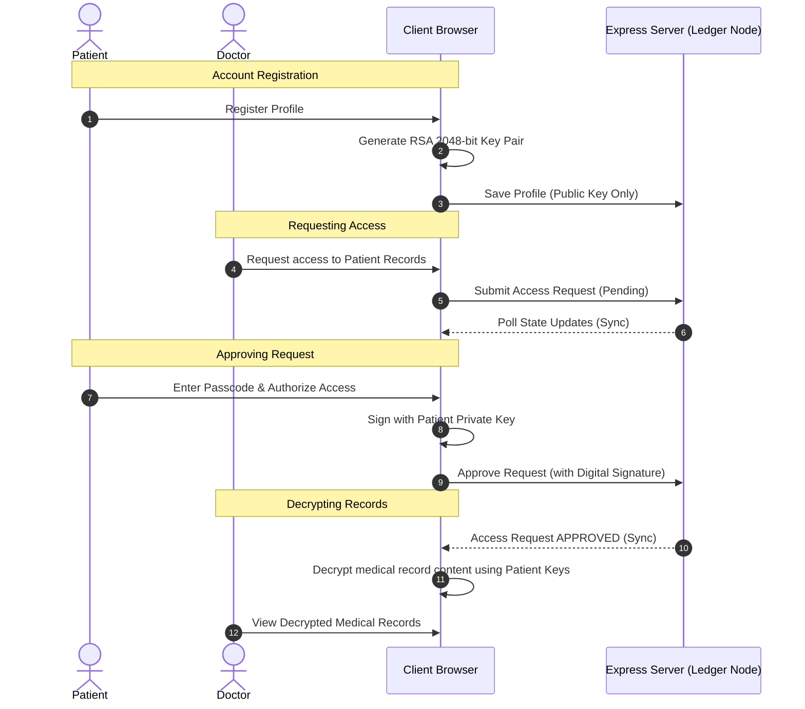

# 🛡️ MedSafe — Sovereign Medical Locker & Prescription Intelligence Network

[](https://react.dev)
[](https://vite.dev)
[](https://tailwindcss.com)
[](https://www.typescriptlang.org)
[](https://expressjs.com)
[](https://firebase.google.com)
[](https://deepmind.google/technologies/gemini)

**MedSafe** (also known as the *Primacy Patient Medical Ledger*) is a next-generation, patient-centric medical locker system. It addresses the privacy, security, and interoperability challenges of modern health systems by putting medical data ownership entirely back in the hands of the patient. 

Through client-side asymmetric cryptography, OTP multi-factor authentication, real-time node synchronization, clinical intelligence, and AI-powered document processing, MedSafe ensures that a patient's medical history is encrypted by default and only decrypted when explicit, digitally-signed consent is authorized.

---

## 🏗️ Architecture & Security Model

MedSafe operates under a **Zero-Knowledge / Sovereign Identity** paradigm:

1. **Client-Side Key Generation**: Upon account creation, the patient's browser generates a custom **2048-bit RSA Asymmetric Key Pair**. The private key resides only in client-side secure memory (never uploaded to the server).
2. **Zero-Knowledge Encryption**: When medical records (prescriptions, lab tests, diagnoses) are uploaded, they are encrypted *in the browser* using the patient's Public Key before transit. The server only sees and stores the ciphertext (`CIPHER_VAULT_AES_256:[IV]:encoded`).
3. **Explicit Consent & Delegation**: Doctors cannot read medical records by default. To request read permission, they must submit an **Access Request** detailing their clinical justification.
4. **Digital Consent Signature**: The patient approves or revokes request status using their private key to compute a cryptographic digital signature (`SHA256-RSA-SIG:...`).
5. **Decryption on Demand**: Once access is approved, the doctor's browser uses the digital signature and patient details to decrypt the records locally. The server never holds, sees, or processes the decrypted content.



---

## 🔄 End-to-End Core Workflows

### 1. Patient Registration & Keycard Provisioning
* **Flow**: The patient registers via the Auth interface.
* **Cryptography**: The client browser generates a public/private keypair using `generateKeyPair` in [cryptoSim.ts](file:///c:/Users/user/Desktop/CIT%20Projects/Med-Safe/MedSafe/src/utils/cryptoSim.ts). 
* **Keycard Generation**: The patient receives a visual keycard containing their Public and Private keys. The Private Key is protected behind a local security passcode.
* **Server Action**: The server registers the profile metadata along with the *Public Key*. The *Private Key* is excluded from transmission.

### 2. Multi-Factor OTP Authentication & SMTP Integration
* **Flow**: User logins trigger a 6-digit verification code.
* **SMTP Delivery**: The server uses Nodemailer to send a rich HTML email to the user's address.
* **Local Fallback**: If no SMTP credentials are provided, the system falls back to printing the OTP code directly to the server terminal to facilitate testing.

### 3. Doctor Search, Dossier QR Scanning, and Justification Requests
* **Flow**: Doctors can search patients in the network directory.
* **Quick Lookup**: Doctors can scan a patient's physical or digital QR card using one of three modes:
  * **Interactive Simulation Station**: Fast-track testing by simulating holographic laser line scans.
  * **Live Camera**: WebRTC stream decoding frames in real-time via `jsQR` with audio chime confirmations.
  * **File Upload**: Parsing screenshots of patient QR passes directly.
* **Justified Access Request**: Upon identification, the doctor submits a clinical justification request (e.g., cardiologist reviewing medication list).

### 4. Digital Consent Signing & Revocation
* **Flow**: Patients receive real-time push alerts on their dashboard when a doctor requests access.
* **Action**: To approve, the patient enters their passcode to unlock the private key and signs the request.
* **Cryptographic Proof**: The signature is generated via `SHA-256` hashing and RSA simulation.
* **Revocation**: The patient can revoke the active permissions at any time, instantly invalidating the doctor's decryption handshake on the next sync interval.

### 5. Browser-Side AES-256 Record Encryption & Decryption
* **Flow**: When a record is added (by the patient or an approved doctor), it is encrypted using the patient's public key.
* **Data Flow**: Plaintext $\rightarrow$ `btoa` encoding $\rightarrow$ salt + IV generation $\rightarrow$ cipher wrapping $\rightarrow$ server database payload.
* **Interactive Visualizer**: The UI renders an `EncryptionVisualizer` component that displays the text scrambling and transition from plaintext to ciphertext in real-time.

### 6. AI-Powered OCR Analysis (Google Gemini integration)
* **Flow**: Patients or doctors can drag and drop scanned reports (like chest X-rays, MRI scans, or prescription receipts).
* **AI Processing**: The image is read as a Base64 payload and dispatched to **Gemini 2.0 Flash**.
* **Structured Output**: Gemini parses the raw image text and returns a validated JSON payload containing the structured title, medical category, doctor name, clinical findings, and prescribed drugs.
* **Local Simulation fallback**: If no API key is present, the app matches filenames (e.g. `mri.png`, `xray.png`, `ecg.png`) and executes a mock clinical analyzer.

### 7. Clinical Contraindication Engine (Drug-to-Drug Interaction)
* **Flow**: When a doctor attempts to prescribe a new medicine, the system runs an automatic contraindication check against existing treatments.
* **Safety Rules**: Checks against a built-in medical database (e.g., combining Nitroglycerin with Sildenafil raises a `CRITICAL` alert; Simvastatin with Amiodarone raises a `MODERATE` warning).
* **Clinician Action**: The dashboard highlights critical risks and displays immediate resolution guidelines before the prescription can be finalized.

### 8. Immutable Cryptographic Audit Logs
* **Flow**: Every event (login, key unlock, consent updates, records creation) writes a block to the system ledger.
* **Integrity**: Each ledger record calculates a cryptographic SHA-256 signature combining action details, timestamps, and actor role to simulate blockchain ledger integrity.

---

## 🛠️ Tech Stack & Libraries

### Frontend (Client SPA)
* **React 19**: Powered by React hooks, contexts, and lazy-loading routes.
* **Vite 6**: Rapid hot module replacement (HMR) and custom code-splitting vendor chunks.
* **TailwindCSS 4**: Custom styling system supporting dark-mode elements and premium glassmorphic UI.
* **Motion (Framer Motion)**: Hardware-accelerated UI transitions and micro-animations.
* **jsQR**: Fast canvas-based image scanning for reading QR passes.
* **Lucide React**: High-quality SVG vector icon set.

### Backend (Ledger Node)
* **Express & Node.js**: REST API endpoints for user records, consents, and logging.
* **tsx**: Real-time TypeScript runtime support for testing and execution.
* **Nodemailer**: Email distribution client with support for custom SMTP servers and SSL handshakes.
* **Google GenAI SDK**: Integrates the `gemini-2.0-flash` model for structured JSON schema extraction.
* **Firebase Realtime Database**: Synchronizes database states remotely if a project URL is specified in the configurations.
* **esbuild**: Bundler for compiling the server script into a single, high-performance Node file (`dist/server.cjs`).

---

## 📁 Project Structure

```text
MedSafe/
├── .env                  # Local secrets and connection strings (ignored by Git)
├── .env.example          # Environment setup template
├── index.html            # Entry HTML document (loads Google Inter/Outfit fonts)
├── package.json          # Dependency and build definitions
├── server.ts             # Express application & Ledger API endpoints
├── tsconfig.json         # TypeScript configuration
├── vite.config.ts        # Vite configuration & Rollup code-splitting chunks
├── replace-logo.js       # Logo utility script
├── public/               # Static assets
└── src/
    ├── main.tsx          # React mount point
    ├── App.tsx           # Global state, router, and live sync polling loop
    ├── firebase.ts       # Firebase client configuration
    ├── types.ts          # Core TypeScript interfaces (UserProfile, MedicalRecord, etc.)
    ├── utils/
    │   └── cryptoSim.ts  # RSA keygen, AES-256 ciphers, and Contraindication engine
    └── components/
        ├── AuthPage.tsx             # Login, registration, and OTP validation screens
        ├── DoctorDashboard.tsx      # Patient index, justification request form, and records creator
        ├── PatientDashboard.tsx     # Vault keys, consent management, and audit log viewer
        ├── QRScanner.tsx            # Camera stream and file QR parser
        ├── EncryptionVisualizer.tsx # Visual comparison of plaintext vs ciphertext
        ├── LandingPage.tsx          # Marketing hero section, workflows preview, and step walkthroughs
        └── Logo.tsx                 # Branding vector logo component
```

---

## ⚙️ Environment Configuration

To run the application, copy the example environment file and configure the variables:

```bash
cp .env.example .env
```

| Variable | Description | Default Value |
| :--- | :--- | :--- |
| `PORT` | Local server port | `3000` |
| `GEMINI_API_KEY` | Google Gemini API key (for structured OCR) | *Optional* (falls back to mock scanner) |
| `FIREBASE_DATABASE_URL` | Firebase database endpoint | *Optional* (falls back to in-memory DB) |
| `SMTP_SERVER` | Mail server hostname | `smtp.gmail.com` |
| `SMTP_PORT` | Mail server port | `587` |
| `EMAIL` | Sender email address for OTP | `medsafeotp@gmail.com` |
| `APP_PASSWORD` | Gmail App Password (to bypass OAuth) | *Optional* (falls back to terminal logging) |

---

## 🚀 Getting Started

### 1. Prerequisites
Ensure you have **Node.js (v18+)** and **npm** installed on your system.

### 2. Installation
Install the project dependencies:
```bash
npm install
```

### 3. Running the Development Server
Launch the Express server and Vite frontend simultaneously:
```bash
npm run dev
```
Open [http://localhost:3000](http://localhost:3000) in your web browser.

### 4. Compiling for Production
Build both the React client assets and bundle the Express server file:
```bash
npm run build
```
This generates:
* Client-side assets in `dist/`
* Compiled backend script in `dist/server.cjs`

To start the production server:
```bash
npm run start
```

---

## 👥 Pre-seeded Demonstration Profiles

The database initializes with three accounts pre-seeded for testing. All accounts share the passcode and password `password`.

| Name | Role | Email | Details |
| :--- | :--- | :--- | :--- |
| **Eleanor Vance** | Patient | `eleanor@vance.io` | Pre-seeded with 2 encrypted vault records. |
| **Dr. Robert Chen** | Doctor | `chen@metrocardio.org` | Cardiology license. Has an approved access request for Eleanor. |
| **Dr. Sarah Lin** | Doctor | `lin@neurohealth.com` | Neurology license. Has a pending access request for Eleanor. |

---

## 🔒 Production Security Recommendations
* **HTTPS enforced**: Production deployment requires TLS/SSL. WebRTC camera permissions require a secure context (HTTPS) to function.
* **Secure Memory Bounds**: Private keys should be stored in SessionStorage rather than LocalStorage to guard against Cross-Site Scripting (XSS) extraction.
* **Secret Rotation**: Rotate SMTP passwords and API keys regularly. Ensure the server firewall blocks access to internal ledger state endpoints.
